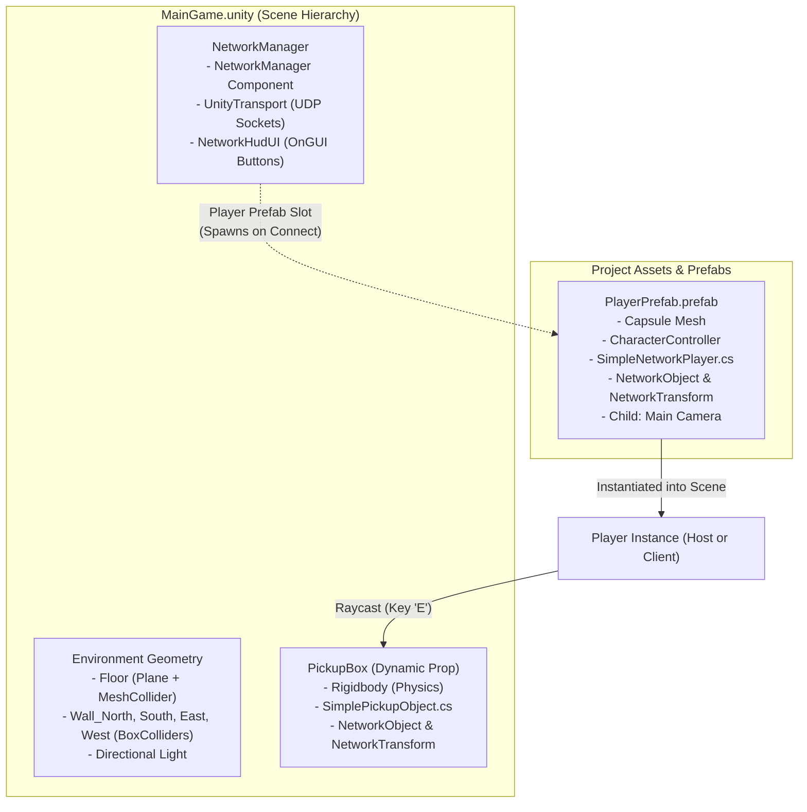
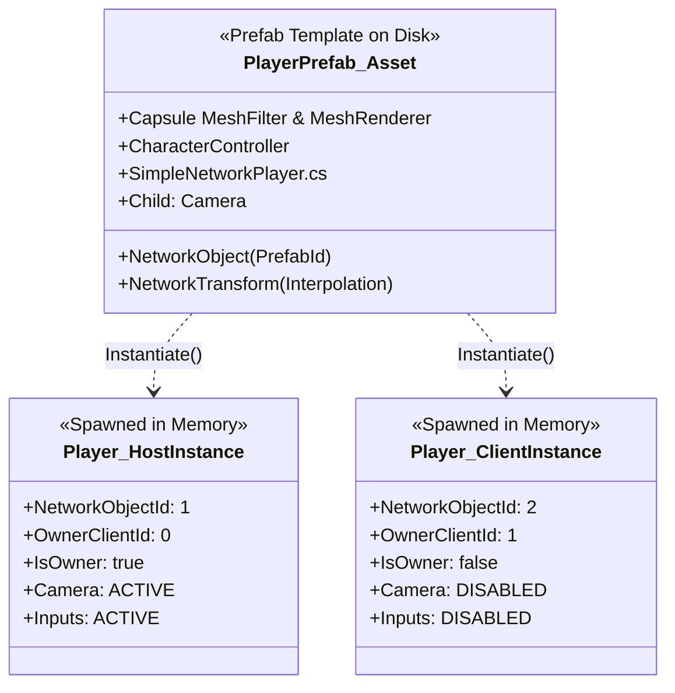
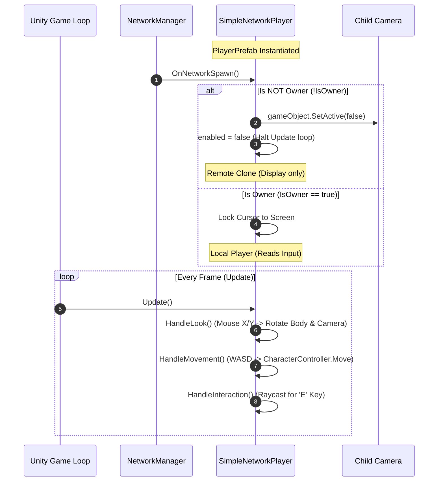

# SandboxGame: Architecture & Codebase Deep Dive

This document provides a comprehensive technical breakdown of the `SandboxGame` codebase for software engineers. It explains how all the pieces connect across scene objects, prefabs, networking synchronization, character control, and physics interactions.

---

## 1. High-Level System Architecture



### The Separation of Concerns
1. **Scene File (`MainGame.unity`)**: Contains the persistent, static world (the room, the lighting, the `NetworkManager`, and initial interactive props). Notice that **no players exist in the scene file**—the scene only defines the rules and arena.
2. **Prefabs (`Assets/_Game/Prefabs/`)**: Reusable templates stored as serialized YAML on disk. The `PlayerPrefab` is kept outside the scene so the `NetworkManager` can spawn as many copies as needed (Player 1, Player 2, Player N).
3. **Scripts (`Assets/_Game/Scripts/Starter/`)**: C# logic driving input, physics, and networking hooks. Compiled under `Game.asmdef` for instant assembly reload.

---

## 2. Prefabs: How Templates Work in Unity

In standard software, think of a **Prefab** as a **Class blueprint** and a scene instance as an **Instantiated object in memory** (`new PlayerPrefab()`).



### Why We Use a Prefab for the Player
* If Player 1 and Player 2 were placed manually in the scene file, git merge conflicts would occur whenever two people tweaked player properties.
* By turning the Player into `PlayerPrefab.prefab`, any edits made to the prefab automatically propagate to all spawned players, both local and networked.

---

## 3. How the Player Works (`SimpleNetworkPlayer.cs`)

The player is composed of 3 primary subsystems: **Networking Identity**, **First-Person Look**, and **Movement Physics**.



### 1. The Critical `OnNetworkSpawn()` Guard
In Netcode for GameObjects, **every client has a local copy of every player in the scene**.
* If Player 1 and Player 2 are in the room, Player 1's computer runs two player GameObjects: Player 1 (owned) and Player 2 (clone).
* If both GameObjects had active cameras and input scripts, Player 1's keyboard would control both characters at once, and their screens would fight over which camera renders!
* The guard prevents this:
  ```csharp
  if (!IsOwner)
  {
      _playerCamera.gameObject.SetActive(false); // Only look through MY camera
      enabled = false;                           // Don't read keyboard for other players
      return;
  }
  ```

### 2. Dual-Axis Mouse Look
* **Horizontal Look (Mouse X)**: Rotates the entire player body (`transform.Rotate(Vector3.up * mouseX)`). This ensures the player actually turns and walks in the direction they face.
* **Vertical Look (Mouse Y)**: Pitches *only* the child camera up and down (`_verticalLookRotation`), clamped between `-80°` and `+80°`. This prevents the capsule body from comically flipping upside-down.

### 3. Kinematic Character Controller Movement
Instead of pushing rigidbodies with forces, `CharacterController.Move()` uses a specialized sweep-and-prune capsule collider:
* Slopes, steps, and door frames are handled smoothly without getting snagged on corner vertices.
* Gravity accumulates in `_verticalVelocity` and applies downward movement each frame.

---

## 4. How the Pickup & Drop Interaction Works (`SimplePickupObject.cs`)

Picking up a physical object in a multiplayer game requires coordinating between **client prediction**, **server authority**, and **physics simulation**.

```mermaid
sequenceDiagram
    autonumber
    actor P1 as Player 1 (Client)
    participant Box as PickupBox
    participant Server as Host / Server
    actor P2 as Player 2 (Remote Observer)

    P1->>P1: Press 'E' while aiming at PickupBox
    P1->>Box: Pickup(NetworkObjectId)
    Box->>Server: RequestPickupRpc(carrierId) [Rpc SendTo.Server]
    
    Note over Server: Server validates carrier exists
    Server->>Box: AttachToCarrierClientRpc(carrierId) [SendTo.ClientsAndHost]
    
    par Update on Player 1
        Box->>Box: isHeld = true, useGravity = false
        Note over Box: Smooth physics pull in FixedUpdate()
    and Update on Player 2
        Box->>Box: isHeld = true, useGravity = false
        Note over Box: Sees box smoothly follow Player 1
    end
```

### The 3 Challenges Solved by This Code

#### 1. Why Not Just Parent the Object? (`transform.SetParent`)
In single-player games, grabbing an item is often done by parenting it to the player's hand (`box.transform.parent = hand`). 
* In networked physics games, hard-parenting causes items to clip through walls, glitch collision boundaries, and stutter over network interpolation.
* Instead, `SimplePickupObject` leaves the box unparented and uses a **Spring Pull** in `FixedUpdate()`:
  ```csharp
  Vector3 targetPos = _currentCarrierTransform.position + _currentCarrierTransform.forward * 1.5f + Vector3.up * 0.5f;
  Vector3 delta = targetPos - transform.position;
  _rigidbody.linearVelocity = delta * 12f;
  ```
  The box physically glides toward the player's front hands. If the player walks into a wall, the box collides and stays outside the wall rather than clipping into geometry.

#### 2. RPC Coordination: Server Authority
Clients cannot simply tell each other *"I own this box now"*—cheat prevention and desync resolution require a central truth:
1. **Client Request**: `RequestPickupRpc(carrierId)` sends a packet to the server saying: *"Player #2 wants to grab this box"*.
2. **Server Broadcast**: `AttachToCarrierClientRpc(carrierId)` is sent by the server to **all connected machines**, ensuring Player 1 and Player 2 both see the box floating in front of the carrier.

#### 3. Releasing & Throwing
When `Drop()` is called, `ReleaseCarrierClientRpc` restores standard gravity (`useGravity = true`) and imparts a small forward velocity impulse (`linearVelocity = Vector3.forward * 2f`), allowing players to toss the box to each other.

---

## 5. Summary Cheat Sheet for Developers

Component / Script | Where It Lives | Primary Purpose
:--- | :--- | :---
`MainGame.unity` | `Assets/_Game/Scenes/` | Scene container with room colliders, lights, and initial props.
`NetworkManager` | GameObject in `MainGame` | Server socket daemon. Manages connections and auto-spawns players.
`NetworkHudUI.cs` | Attached to `NetworkManager` | Immediate-mode UI buttons (**Start Host** / **Start Client**).
`PlayerPrefab.prefab` | `Assets/_Game/Prefabs/` | The capsule player template spawned for each player.
`SimpleNetworkPlayer.cs` | Component on `PlayerPrefab` | WASD movement, mouse pitch/yaw, and Raycast interaction trigger.
`PickupBox` | GameObject in `MainGame` | The dynamic physics cube in the room.
`SimplePickupObject.cs` | Component on `PickupBox` | Networked physics follower syncing carry state across clients.
`NetworkTransform` | Components on Box & Player | Synchronizes position/rotation over UDP with client interpolation.
