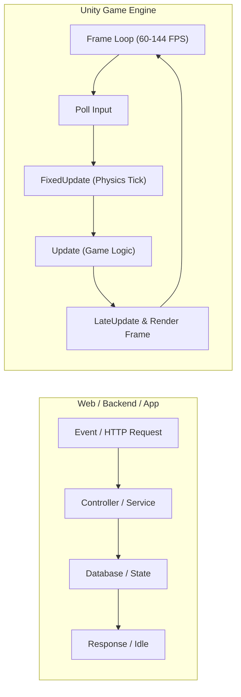
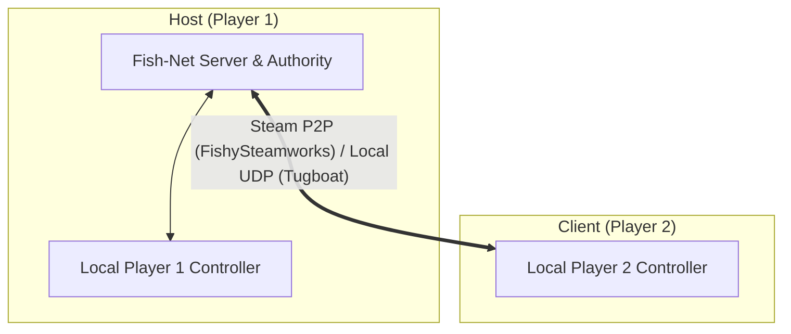

# The Software Engineer's Guide to Unity & Multiplayer Game Dev

Welcome to game development. As a software engineer, you already know data structures, algorithms, async logic, and version control. However, game engines operate on an entirely different mental model than web, backend, or desktop applications.

This guide bridges that gap and gives you and your friend a clear, step-by-step roadmap to build your first prototype: **1 Room, 2 Players, and 1 Object**.

---

## 1. The Core Mental Model Shifts



### Shift 1: Continuous Loop vs. Event-Driven / Request-Response
In standard software, your code sleeps until an event (HTTP request, button click, queue message) arrives.
* In Unity, your code executes continuously every single frame (e.g., 60 to 144 times per second).
* **`Update()`**: Runs every frame. Used for polling inputs, timers, and visual updates (`Time.deltaTime`).
* **`FixedUpdate()`**: Runs at a locked physics cadence (default 50Hz, `Time.fixedDeltaTime`). All Rigidbody forces and physics calculations belong here.
* **Golden Rule**: **Never block the main thread** (no `Thread.Sleep`, synchronous I/O, or infinite loops). Blocking halts the entire rendering engine.

### Shift 2: Entity-Component System (Composition over Inheritance)
Traditional OOP often encourages deep class hierarchies (`Animal -> Mammal -> Dog`). Unity uses an **Entity-Component** model:
* **`GameObject`**: An empty container with a position, rotation, and scale (its `Transform`). That is all it is.
* **`Component`**: A modular script or built-in module attached to a GameObject that gives it behavior or properties:
  * Want it visible? Attach a `MeshRenderer` + `MeshFilter`.
  * Want it to have physical mass? Attach a `Rigidbody`.
  * Want it to bump into walls? Attach a `BoxCollider`.
  * Want custom movement? Attach your C# script inheriting from `MonoBehaviour`.

### Shift 3: Serialization & The Inspector (Code is only 50% of the program)
In backend engineering, code is the source of truth. In Unity:
* Scenes (`.unity`), Prefabs (`.prefab`), and ScriptableObjects (`.asset`) are **serialized YAML files**.
* When you declare `[SerializeField] private float _speed = 5f;`, the Unity Editor Inspector displays this variable.
* If you change that value to `10f` in the Inspector, the serialized asset overrides your code's default value.
* References between objects (e.g., assigning a Camera to a Player script) are wired up in the Inspector by dragging and dropping, saved as GUID references.

### Shift 4: The "Over-Engineering" Trap
Engineers entering game dev often try to build enterprise architectures: abstract factory factories, dependency injection containers, and giant manager singletons before writing a single gameplay mechanic.
> [!TIP]
> Keep it lean. Game code is gameplay-centric and iterates rapidly. Build small, self-contained components that query or communicate via events and interfaces.

---

## 2. Git & Version Control with a Teammate

Collaborating on Unity via Git requires specific hygiene to avoid corrupting scenes and references.

```
SandboxGame/
├── Assets/              # Committed (Your code, models, scenes, prefabs)
│   ├── *.meta           # CRITICAL: Always committed with every asset!
├── Packages/            # Committed (manifest.json package dependencies)
├── ProjectSettings/     # Committed (Input, physics, tag settings)
├── .gitignore           # Committed (Ignores Library/, Temp/, Logs/)
├── .gitattributes       # Committed (Tracks large binary assets via Git LFS)
└── Library/             # IGNORED! Local cache generated automatically by Unity
```

### Rule 1: The Sacred `.meta` Files
Every file and folder in `Assets/` has an accompanying `.meta` file (e.g., `Player.cs` has `Player.cs.meta`).
* Unity assigns each asset a unique 128-bit **GUID** stored inside its `.meta` file.
* Scene files reference scripts and models **only by their GUID**, never by file name or path.
* **The Rule**: When you add, rename, or move a file in Git, you **must commit its `.meta` file at the same time**. If a `.meta` file is missing, references break into "Missing (MonoScript)".

### Rule 2: Avoiding the "Scene Merge Nightmare"
Unity `.unity` scene files are massive YAML text files detailing hundreds of GameObjects and IDs.
* Merging git branches that both modified the same scene file is notoriously painful and often causes corruption.
* **The Solution**: **Work in Prefabs!**
  * Prefabs are reusable asset templates (`Player.prefab`, `Room.prefab`, `PickupBox.prefab`).
  * If your friend is working on player movement and you are building the room layout, your friend edits `Player.prefab` while you edit `Room.prefab`.
  * Neither of you touches the base `SampleScene.unity`, resulting in zero merge conflicts.

### Rule 3: Git LFS (Large File Storage)
3D models (`.fbx`), audio files (`.wav`), and textures (`.png`) are binary files. Regular Git stores a complete copy of every binary file on every commit, quickly bloating repos to dozens of gigabytes.
* The `.gitattributes` file already placed in this project automatically routes binary files through **Git LFS**.

---

## 3. Multiplayer Mental Model (Fish-Net + FishySteamworks)



### Host-Client via Steam P2P
* **Host**: One player acts as the server while also playing the game locally.
* **Client**: Other players connect via Steam lobby invite or SteamID (via **FishySteamworks**).
* **Why**: Zero dedicated server hosting costs, zero port forwarding, native Steam friend invites.

### Key Concepts
1. **`NetworkManager`**: The core component in your scene managing server and client connections.
2. **`PlayerSpawner`**: Automatically instantiates the player prefab whenever a client connects.
3. **`NetworkObject`**: Attached to any GameObject that needs to exist across the network.
4. **`NetworkBehaviour`**: Base class replacing `MonoBehaviour` for networked scripts:
   * `base.IsServerInitialized`: True if running on the server/host.
   * `base.IsClientInitialized`: True if running on a client.
   * `base.IsOwner`: True if *this specific machine* owns this object.
5. **State Synchronization**:
   * **`[SyncVar]`**: Replicates state from server to clients (e.g. `[SyncVar] public int Health;`).
   * **`[ServerRpc]`**: Method called on client that executes on server (e.g. "Request pick up item").
   * **`[ObserversRpc]`**: Method called on server that executes on all clients (e.g. "Play sound effect").

---

## 4. The "1 Room, 2 Players, 1 Object" Blueprint

```
[ Step 1: The Room ] ----> [ Step 2: The Object ] ----> [ Step 3: The Player ]
                                                                 |
                                                                 v
[ Step 5: Test 2 Players ] <---- [ Step 4: Network Setup ] <-----+
```

### Step 1: The Room
* Create a 3D Plane (`Floor`) at `(0, 0, 0)` with a `MeshCollider`.
* Create 4 Cubes scaled as walls (e.g., scale `(10, 3, 0.5)`) around the edges with `BoxCollider`s.

### Step 2: The Object
* Create a 3D Cube (`PickupBox`) at `(0, 0.5, 3)`.
* Components: `BoxCollider`, `Rigidbody`, `SimplePickupObject`.

### Step 3: The Player Prefab
* Create a 3D Capsule (`Player`) with `CharacterController`.
* Child `Camera` at eye level `(0, 0.6, 0)`.
* Attach `SimpleNetworkPlayer` with WASD + Mouse look + Grab/Drop (`E`).
* Saved as `Assets/_Game/Prefabs/PlayerPrefab.prefab`.
