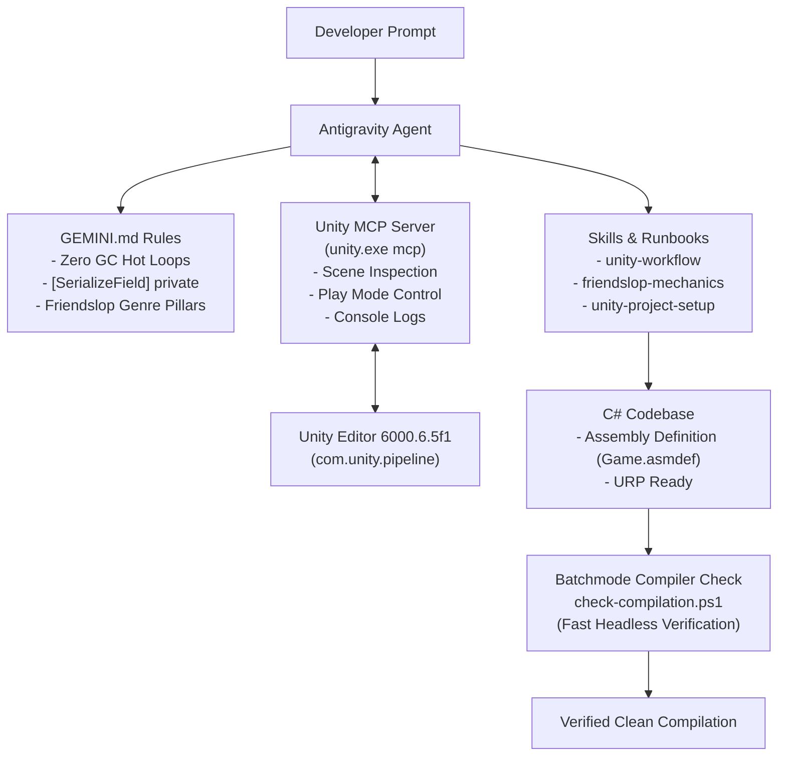

# Unity 6 & "Friendslop" Game Setup Guide

This workspace is fully configured for high-velocity Unity 6 game development with an emphasis on **friendslop** games (chaotic physics co-op, proximity voice, active ragdolls, and emergent comedy like *Lethal Company*, *Content Warning*, *Phasmophobia*, and *Chained Together*).

---

## 1. System Architecture & Workflow

---

## 2. Unity MCP Integration

The agent is connected to the official **Unity CLI MCP Server** via Antigravity's global configuration.

* **MCP Configuration File**: `C:\Users\kvnla\.gemini\config\mcp_config.json`
* **Server Command**: `C:\Users\kvnla\AppData\Local\Unity\bin\unity.exe mcp`
* **In-Editor Bridge**: `com.unity.pipeline` (`0.8.0-exp.1`) in `Packages/manifest.json`
* **Capabilities**:
  * Live inspection of GameObjects and scene hierarchy
  * Reading Editor console logs and runtime exceptions in real time
  * Toggling Play/Pause/Stop mode
  * Triggering script recompilation and asset database refreshes

---

## 3. Project Structure & Organization

File / Folder | Purpose
:--- | :---
[`Packages/manifest.json`](../Packages/manifest.json) | Configured with URP, Input System, Cinemachine, TextMeshPro, and `com.unity.pipeline`.
[`Assets/_Game/Scripts/Game.asmdef`](../Assets/_Game/Scripts/Game.asmdef) | Isolated assembly definition providing fast script compilation.
[`SimplePickupObject.cs`](../Assets/_Game/Scripts/Starter/SimplePickupObject.cs) | Physical item with smooth spring hold-point following and drop momentum.
[`SimpleNetworkPlayer.cs`](../Assets/_Game/Scripts/Starter/SimpleNetworkPlayer.cs) | First-person character controller with WASD, Sprint, Jump, Mouse Look, and Grab/Drop (`E`).
[`NetworkHudUI.cs`](../Assets/_Game/Scripts/Starter/NetworkHudUI.cs) | Immediate-mode screen guide for controls.
[`Assets/_Game/Scenes/MainGame.unity`](../Assets/_Game/Scenes/MainGame.unity) | The 1 Room scene (Floor + 4 Walls + PickupBox + Player).
[`Assets/_Game/Prefabs/PlayerPrefab.prefab`](../Assets/_Game/Prefabs/PlayerPrefab.prefab) | Reusable player prefab with first-person camera and character controller.

---

## 4. How to Test

1. Open `MainGame.unity` in the Unity Editor.
2. Press **Play (▶)** at the top.
3. Move with **WASD**, look around with **Mouse**, jump with **Space**.
4. Walk up to the green/white `PickupBox` and press **E** to pick it up and carry it. Press **E** again to drop it!
